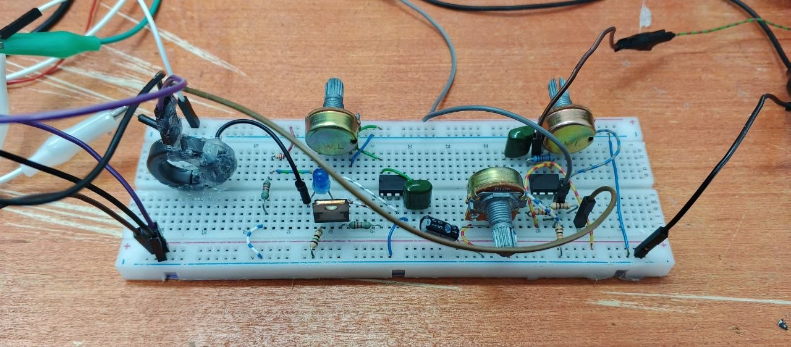
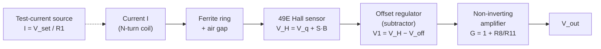
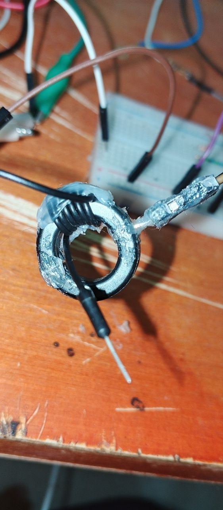
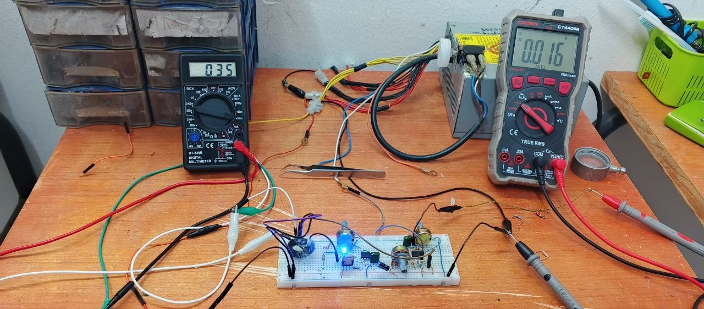

<div align="center">

# Hall Effect Current Sensor

**A contactless, isolated current sensor built from scratch: ferrite-ring sensor head, 49E Hall element, offset-nulling stage, adjustable gain and a programmable test-current source.**




</div>

---

## Table of contents

1. [Overview](#overview)
2. [Features](#features)
3. [How it works](#how-it-works)
4. [Sensor head](#sensor-head)
5. [Circuit description](#circuit-description)
6. [Bill of materials](#bill-of-materials)
7. [Build and calibration](#build-and-calibration)
8. [Results](#results)
9. [Limitations and improvements](#limitations-and-improvements)
10. [Repository structure](#repository-structure)
11. [Author](#author)

---

## Overview

A normal shunt resistor measures current by adding resistance to the circuit and offers no electrical isolation. This project measures current **magnetically** instead:

1. The current flows through a coil wound on one side of a **ferrite ring**.
2. The ring concentrates the magnetic field in a small **air gap**.
3. A linear **49E Hall effect sensor** in the gap converts the field into a voltage.
4. Analog electronics **remove the sensor offset** (so 0 A gives 0 V) and **amplify** the signal.

A separate **test-current circuit** generates any current you need by turning a potentiometer, so the sensor can be characterised without a lab power supply.

## Features

- Contactless measurement with isolation between the measured current and the sensing electronics
- Bidirectional output: positive and negative current give positive and negative voltage
- Adjustable **zero** (offset potentiometer) and adjustable **gain**
- Slow RC filter on the offset reference to keep it quiet and stable
- Built-in **programmable current source** for calibration and testing
- Full design files, schematic and a LaTeX report

## How it works



**Magnetic circuit.** For a core with a narrow gap of width *g*, most of the magnetomotive force falls across the gap:

$$B \approx \frac{\mu_0 N I}{g}$$

**Hall sensor.** The 49E is linear and ratiometric. With no field its output sits at about half the supply (about 2.5 V at 5 V), and it moves with the field:

$$V_H = V_q + S\,B$$

**Signal chain.** The offset stage subtracts a reference set with a potentiometer, then the amplifier applies the gain:

$$V_{out} = G\,(V_H - V_{off}), \qquad G = 1 + \frac{R_8}{R_{11}}$$

When $V_{off} = V_q$, the output is proportional to the current:

$$V_{out} = G\,S\,\frac{\mu_0 N}{g}\,I = S_I\,I$$

**Test-current source.** The op-amp forces the voltage across the 75 Ω resistor R1 to equal the potentiometer voltage, so:

$$I = \frac{V_{set}}{R_1}$$

## Sensor head

The sensor head is a ferrite ring with a small air gap. The measured wire is wound on one side of the ring, and the 49E Hall sensor sits in the gap with its flat face perpendicular to the magnetic field.

<div align="center">

| Sensor head (photo 1) | Sensor head (photo 2) |
|:-:|:-:|
|  |  |

</div>

| Parameter | Value |
|-----------|-------|
| Ferrite ring (outer / inner diameter, thickness) | TBD |
| Air gap g | TBD mm |
| Number of turns N | TBD |
| Wire diameter | TBD mm |
| Sensor position | Centered in the gap, flat face perpendicular to the field |

> **Tip:** file names with spaces or brackets, like `photo_2026-11-23_22-12-19 (2).jpg`, can break image links. This README uses `%20` for the space. Renaming the photo (for example to `sensor-head-1.jpg`) is more reliable.

## Circuit description


> The schematic is drawn in KiCad. Some symbols are stand-ins for the parts actually used (for example the Hall sensor symbol and the op-amp symbols). The functions and pinouts are the same.

### 1. Current adjust circuit (test source)

| Part | Role |
|------|------|
| Op-amp U1 | Compares the set voltage with the voltage across R1 and drives the transistor |
| R2, R4 | Voltage divider from +12 V that fixes the maximum set voltage |
| RV2 (10 kΩ) | Sets the reference voltage $V_{set}$, so it sets the current |
| R3 (1 kΩ) | Base resistor for the transistor |
| Q1 (NPN, TIP122) | Pass transistor that carries the current |
| R1 (75 Ω) | Current-sense resistor, $I = V_{set}/R_1$ |
| D1 (LED) | Load and visual indicator in the collector path |

The sensor coil is connected in series with this current path. Because the loop is regulated, the current does not depend on the load voltage.

### 2. Hall effect sensor

The 49E is powered from **+5 V**. Its output is about 2.5 V at zero field and moves up or down with the field direction. Because it is ratiometric, the offset reference below is taken from the same +5 V rail, so supply variations are largely cancelled.

### 3. Offset regulator

A unity-gain **difference amplifier** (all resistors 10 kΩ) built on a dual supply of **±5 V**.

- **RV1 (10 kΩ)** forms a divider from +5 V to produce the reference $V_{off}$.
- **R5 and C3 (10 µF)** make a slow low-pass filter that keeps the reference quiet.
- **R9 and R10** set the difference-amplifier gain to 1.
- **C2 (100 nF)** decouples the op-amp supply.

With zero current, RV1 is adjusted until $V_{off} = V_q$, so the stage output is 0 V.

### 4. Amplifier

A **non-inverting amplifier** on ±5 V. **R8 = 100 kΩ** is the feedback resistor and **R11 (10 kΩ variable)** sets the gain:

$$G = 1 + \frac{100\,k\Omega}{R_{11}}$$

With R11 = 10 kΩ the gain is 11, and it increases as R11 is turned down.

<!-- Add photos of the real conditioning circuit and the real test-current circuit here, for example:

-->

## Bill of materials

| Qty | Component | Value / note |
|-----|-----------|--------------|
| 1 | 49E linear Hall sensor | Linear, ratiometric |
| 1 | Ferrite ring | Dimensions: TBD, with air gap g = TBD mm |
| 3 | Op-amp (LM358 or equivalent) | Test source, offset stage, amplifier |
| 1 | NPN Darlington transistor | TIP122 |
| 1 | LED | Indicator / load |
| 2 | Potentiometer 10 kΩ | RV1 (offset), RV2 (current) |
| 1 | Variable resistor 10 kΩ | R11 (gain) |
| 1 | R1 | 75 Ω (current sense) |
| 1 | R3 | 1 kΩ |
| 1 | R8 | 100 kΩ |
| 5 | Resistors 10 kΩ | R5, R6, R9, R10 and the sensor input resistor |
| 2 | R2, R4 | TBD |
| 1 | C3 | 10 µF |
| 1 | C2 | 100 nF |
| 1 | Winding wire | N = TBD turns |
| | Power supplies | +12 V, +5 V, −5 V |

## Build and calibration

1. **Build the sensor head.** Wind N turns on one side of the ferrite ring and place the 49E in the air gap, flat face perpendicular to the field. Fix it mechanically (see [Sensor head](#sensor-head)).
2. **Power up.** Connect +12 V (test source), +5 V (Hall sensor) and ±5 V (op-amps). Share a common ground.
3. **Zero the output.** With no current, turn RV1 until the output is 0 V.
4. **Choose the gain.** Set R11 for the range you need, without clipping near the ±5 V rails.
5. **Apply a current.** Put the coil in series with the test source and a multimeter in current mode. Turn RV2 to change the current.
6. **Record data.** At each step, write down I and V_out. Reverse the current direction and repeat.
7. **Fit the data.** Plot V_out against I and fit a line to get the sensitivity S_I (V/A).

> **Safety notes:** the LED has no series resistor, because the loop is current-regulated. Keep the set current below the LED's rated current (usually about 20 mA for a standard LED), or replace the LED by a resistive load for higher currents. Check the power dissipated in the transistor, $P \approx (V_{CC} - V_{load} - I R_1)\,I$, and add a heatsink if needed.

## Results

<div align="center">



</div>

| Parameter | Value |
|-----------|-------|
| Number of turns N | TBD |
| Air gap g | TBD mm |
| Gain G | TBD |
| Sensitivity S_I | TBD V/A |
| Linear range | TBD |
| Non-linearity (% FS) | TBD |
| Noise (peak to peak) | TBD mV |

<!-- Add the plot of V_out versus I here, for example:

-->

## Limitations and improvements

**Limitations**
- Sensitive to external magnetic fields, including the Earth's field
- Offset drifts with temperature
- The ferrite can saturate at high current, and it has hysteresis
- Sensitivity depends on gap width and sensor position
- No repeated measurements yet, so accuracy is not quantified

**Planned improvements**
- [ ] Mechanical mount for a fixed sensor position in the gap
- [ ] Repeat the measurements (mean, standard deviation, error)
- [ ] Calibrate against a reference current meter
- [ ] Read V_out with an ESP32 ADC and display the current
- [ ] Add temperature compensation
- [ ] Design a PCB in KiCad

## Repository structure

```
.
├── README.md
├── photo_2026-11-23_22-12-19.jpg       # sensor head, photo 2
├── photo_2026-11-23_22-12-19 (2).jpg   # sensor head, photo 1
├── photo_2026-11-23_22-12-20.jpg       # overview photo
├── photo_2026-11-23_22-12-21.jpg       # measurement photo
├── docs/
│   ├── images/
│   │   └── schematic-full.png          # KiCad schematic
│   └── hall_current_sensor_report.pdf
├── hardware/
│   └── kicad/                          # KiCad project (schematic)
├── report/
│   └── hall_current_sensor_report.tex
└── data/
    └── measurements.csv
```

## Author

**Abderraouf Brada**
Micro and Nano Sensors and Instrumentation, National School of Nanosciences and Nanotechnology (Algeria)
GitHub: [@abderraoufbrada](https://github.com/abderraoufbrada)
